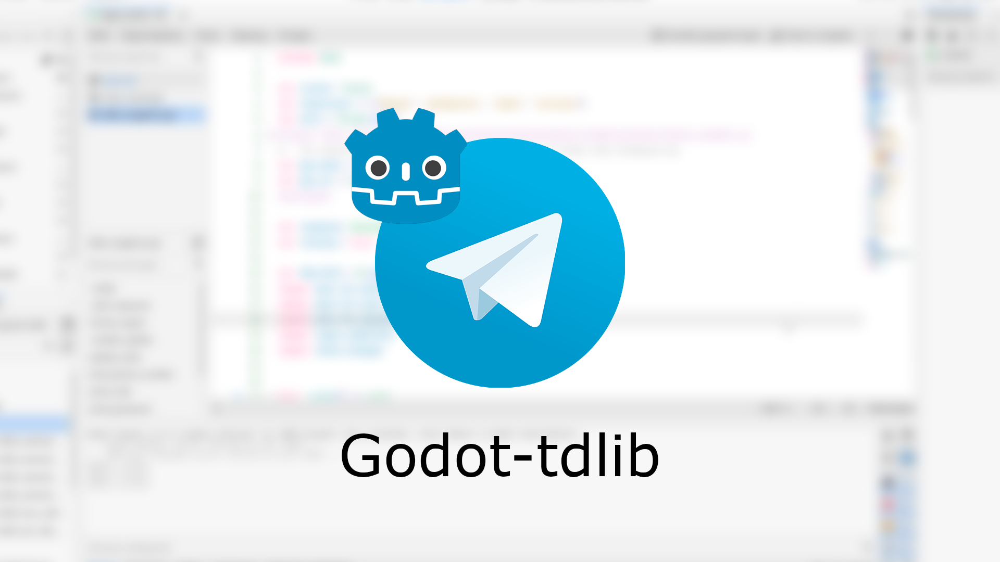

# Godot-tdlib


GDExtension C++ wrapper for working with [TdLib](https://github.com/tdlib/td) (JSON interface) on Godot Engine.

## Features

- `TdJsonManager` - global singleton for TDLib configuration, synchronous requests, logging, and polling.
- `TdJsonClient` - an individual TDLib client. Create one with `TdJsonClient.create()` or `TdJsonManager.create_client()`, send requests with `send()`, and close it with `close_and_destroy()`.
- Receive all updates through `TdJsonManager.request_received`, or connect to a specific client's `response_received` signal.
- Configure TDLib parameters, set a bot token, query the TDLib version, and control log verbosity.
- The extension requires Godot 4.5 or newer.

## Usage

The wrapper can be used to integrate TDLib into a Godot game or application, including a Telegram client. See the [example project](./example) for a working login flow.

Create a client, connect to the manager's response signal, and start the polling thread:
```gdscript
var client: TdJsonClient

func _ready() -> void:
	client = TdJsonClient.create()
	TdJsonManager.request_received.connect(_on_response_received)
	TdJsonManager.start_poll()

func _on_response_received(response: Dictionary) -> void:
	# Handle a TDLib update or the answer to a request.
	print(response)
```

`TdJsonManager.request_received` emits every response received by the manager as one `Dictionary`; `TdJsonClient.response_received` emits responses for that client with its client ID and response dictionary. `TdJsonManager.receive(timeout)` is available for manual polling, but do not call it concurrently with `start_poll()`.

Call `TdJsonManager.set_tdlib_parameters(...)` with your Telegram API credentials before polling; the manager sends them when TDLib requests initialization. Use `client.send(...)` to send TDLib JSON API requests after creating the client. The example project demonstrates both initialization and authentication.

## Build (Linux, Windows)

Install [Python 3.9+](https://www.python.org/) and SCons, then build the TDLib packages and dependencies as described in [thirdparty/README.md](./thirdparty/README.md). From the repository root, build the extension for your native platform:
```shell
scons -j <number-of-cores> target=template_debug
```

## Build (Android)

The provided [Dockerfile](./Dockerfile) uses Android NDK 28.1.13356709. Install [Docker](https://www.docker.com/products/docker-desktop/), build the image, and run SCons with the project directory mounted:
```
docker build -t godot-tdlib-android-builder .
docker run --rm -v ${PWD}:/build godot-tdlib-android-builder scons -j6 platform=android target=template_debug
```
TDLib Android libraries must also be built; see [thirdparty/README.md](./thirdparty/README.md).

## Supported platforms

| Platform | Architectures | Support |
|----------|---------------|:-------:|
| Windows  | x86_64        | ✅ |
| Linux    | x86_64        | ✅ |
| Android  | arm64, arm32, x86_64, x86_32 | ✅ |
| macOS    | —             | ❌ |
| iOS      | —             | ❌ |

## Tests

Run the headless test project from the repository root:
```powershell
.\gen\godot.exe --path .\tests --headless
```
See [tests/README.md](./tests/README.md) for test coverage and the documentation check.
